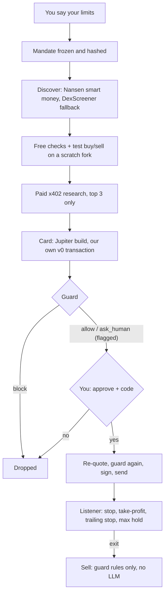

# Vibe Trading

UBC 2026 Hackathon project. Numbers here come from the code or from runs we actually did.

Demo video: https://youtu.be/6_1EUfDedNY

## 1. Summary

Trading meme coins means signing transactions you can't read, and an AI agent with a wallet can be tricked (say by a prompt injection in token metadata) into draining it. Vibe Trading is a voice agent that trades Solana meme coins. It pays for its own research over x402 (USDC on Base), a guard checks every transaction before it's signed, and nothing is bought until you say "approve" plus the card's two-digit code. We did four real mainnet swaps, links in section 5.

## 2. Decision loop



Code: `backend/mandate/`, `backend/discovery/`, `backend/research/`, `backend/execute/cards.py`, `backend/guard/`, `backend/execute/engine.py`, `backend/execute/listener.py`.

## 3. Limits

The agent can't change these. Only your own words can. Raising a limit needs a spoken "confirm", lowering one applies right away.

| Limit | Default |
|---|---|
| Total / per trade / daily max loss | $5 / $1 / $2 |
| Buy approval | "approve" + two-digit code, void after 3 misses or 180 s |
| Own words only | raw browser transcript checked on the backend, agent echoes rejected |
| Slippage / price impact | 300 bps / 2% |
| Research | $1 per session, $0.10 max per call, sellers and prices pinned |
| Mainnet | $5 per buy, SOL fee reserve kept |

Preset in `config/default_mandate.json`, hard caps in `HARD_RULES` (`backend/config.py`).

## 4. The guard

`check_transaction` in `backend/guard/pipeline.py`. Any decode or simulation failure blocks.

1. Decode the signed bytes and load lookup tables from chain.
2. Simulate (`surfnet_profileTransaction` on the fork, `simulateTransaction` with sigVerify on mainnet).
3. Deterministic rules, default deny, 25 block codes (`PROGRAM_NOT_ALLOWED`, `SOL_OUTFLOW`, `OTHER_TOKEN_DECREASE`, `APPROVE`, `SET_AUTHORITY`...). A block is final.
4. Only if the rules pass: JEV scores a structured view with role labels, no addresses, no token names. Risk >= 0.5 or any error gives `ask_human`. JEV can only make it stricter.

Real allow: card 14, 36 rules passed, JEV 0.12 (`docs/evidence/normal-same-run-guard.json`). Injection test: with `VIBE_REDTEAM=1` a test coin's metadata gets a naive builder to append a USDC transfer to the attacker. The rules blocked it before JEV (`docs/evidence/blocked-same-run-guard.json`).

Known gap: a swap into native SOL scores 0.96 and gets `ask_human`, because the view shows 0 output for native SOL.

## 5. Solana

Swaps use Jupiter `GET /swap/v2/build`. We build the v0 transaction ourselves and read lookup tables from chain instead of trusting Jupiter's mapping (`backend/trade/jupiter.py`). No programs of our own.

Guard allowlist:

| Program | ID |
|---|---|
| Jupiter Aggregator v6 | `JUP6LkbZbjS1jKKwapdHNy74zcZ3tLUZoi5QNyVTaV4` |
| SPL Token | `TokenkegQfeZyiNwAJbNbGKPFXCWuBvf9Ss623VQ5DA` |
| Token-2022 | `TokenzQdBNbLqP5VEhdkAS6EPFLC1PHnBqCXEpPxuEb` |
| Associated Token Account | `ATokenGPvbdGVxr1b2hvZbsiqW5xWH25efTNsLJA8knL` |
| Compute Budget | `ComputeBudget111111111111111111111111111111` |
| System | `11111111111111111111111111111111` |

Most testing was on a Surfpool fork (95 swaps). Then four real mainnet swaps from wallet `2hXDjgGJA5JKnE72RKjPdHTdqbCyMh34ae6jKmoAcxxN`, run by a script through the repo's Jupiter build, full guard and `Executor.send`, not the voice UI (`docs/evidence/mainnet_trades.json`):

| Pair | In | Out | Guard | Solscan |
|---|---|---|---|---|
| USDC to BONK | 1 USDC | 443,760.02 BONK | allow, JEV 0.05 | [61e5RnZD…](https://solscan.io/tx/61e5RnZD756DzYWKSP1oVM1FCTMddKdgwcJTnnmsYYe4tcGMbpV3vXiwnFJ5yMsXami7uDLg3gkqemaqoZ4J4CYA) |
| BONK to USDC | 443,760.02 BONK | 0.999055 USDC | allow (rules only) | [2ZyCXccK…](https://solscan.io/tx/2ZyCXccKBgSibCwGSXx3Ld9apqZea7rwN1ucBqqkRb64MWqDuMS4sNB6bkYPtAhbEuuijJ1xNfnHL1Bqqiq4J9Hv) |
| USDC to WIF | 1 USDC | 7.710649 WIF | allow, JEV 0.05 | [5k5yRmf2…](https://solscan.io/tx/5k5yRmf2SciFm8KYm7sr8B7x6n3FWMukkKCgsEG9PkaprNggefyS4qrdqZPc2MJjubejaBKaShcT4LjjQew4H6KJ) |
| WIF to USDC | 7.710649 WIF | 0.997953 USDC | allow (rules only) | [6145EpTZ…](https://solscan.io/tx/6145EpTZTSzKDUfn8uZkzyTPNMEtYqNydAeQL86pKiiTxrvDRzzntqybis9GPQNChN36xGj4s6o6PjZ8yYV4igjs) |

## 6. x402 payments

Nansen smart money $0.05, Nansen holders $0.05, Quick Intel scan $0.03, all USDC on Base. The client refuses a 402 if network, asset, pay-to or price doesn't match `backend/research/sellers.py`, and after paying checks the USDC `Transfer` log on chain. 17 settled payments, $0.67 total, e.g. [0x8fa7b14f…](https://basescan.org/tx/0x8fa7b14f5b12011ed0b5126bd9e975cf5eedbebf849d08d21cceecf8ba756efc). Full list: `docs/evidence/x402_payments.md`.

## 7. ElevenLabs

The whole UI is one ElevenLabs Agents session on `eleven_realtime_v1_max` with 14 client tools in the browser (`frontend/src/voice/tools.ts`). The API key stays on the backend (signed URL). When idle it only answers to "Vibe", side talk is skipped (`frontend/src/voice/engagement.ts`). A shadow listener reads filter changes from the live transcript before the tool call lands: median 2.8 s to 1.7 s (`docs/evidence/shadow_latency_20261111_164021.json`).

## 8. Architecture

```
Browser (Vite + React)         FastAPI backend                    Outside
+----------------------+       +---------------------------+      +--------------------------------------+
| ElevenLabs agent     |<----->| mandate      orchestrator |----->| Nansen, Quick Intel (x402, Base)     |
| 14 client tools      |       | research + budget ledger  |----->| DexScreener, GeckoTerminal           |
| UtteranceStore, UI   |       | cards        guard        |----->| Jupiter, JEV via OpenRouter          |
+----------------------+       | listener     event bus    |----->| Surfpool :8899/:8999, Solana RPC     |
                               +---------------------------+      +--------------------------------------+
```

Duplex: you can keep talking while it works. Tools return in under a second; research, card simulation, buys and the emergency exit run as background tasks (`backend/orchestrator.py`) and the result comes back to the agent as a system update. You can interrupt any time, change filters mid-research (the old round stops, no new payment starts) or say "stop the research". Updates wait while you're speaking, urgent ones at most 4 s (`frontend/src/voice/broadcast.ts`). Approvals are still checked against your words and the code before anything runs.

## 9. Setup

Windows 10/11 or Linux, Python 3.11+, Node.js 20+, Surfpool 1.7.0. Fill in `.env` from `.env.example`. `.env`, `secrets/`, keypairs and `runs/` are gitignored, don't commit keys.

```powershell
copy .env.example .env; .\scripts\dev.ps1 -Setup
.\scripts\dev.ps1                 # rehearsal: replayed data, local fork, no money
.\scripts\dev.ps1 -Mode live      # paid x402 research, trades on the fork
.\scripts\dev.ps1 -Mode mainnet   # real funds, type MAINNET to continue
.\scripts\stop_dev.ps1
```

Linux: `scripts/dev.sh`. More in `docs/run_on_your_pc.md`. Tests: `python -m pytest -q -m "not live"` (499 passed), `cd frontend && npm test -- --run` (102 passed).
